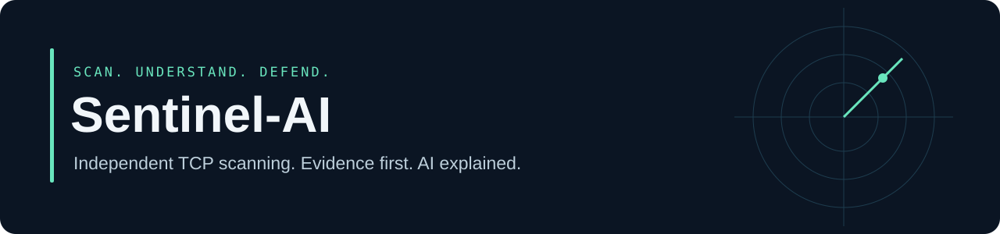

# Sentinel-AI

**Independent TCP scanning, network monitoring, and optional AI explanations.**

Sentinel is a Python security-learning project for checking port exposure and
reviewing network-event evidence. Scanning uses its own socket engine; Nmap and
administrator privileges are not required for the TCP scanner.

[Scanner quick start](#quick-start) · [Monitoring reference](docs/MONITORING.md) ·
[Architecture](docs/ARCHITECTURE.md) · [Contributing](CONTRIBUTING.md) · [Security](SECURITY.md)

## Quick start

Python 3.10+; the scanner requires no third-party Python packages.

```sh
git clone https://github.com/Yuvraj-26-k/Sentinel-AI.git
cd Sentinel-AI
python -m sentinel scan 127.0.0.1 -p 22,80,443
python -m sentinel scan 127.0.0.1 -p 22,80,443 --services --os
python -m sentinel scan 127.0.0.1 -p 1-1024 --open-only --output scan.json
```

Use only systems you own or have permission to test. A scan targets one IP or
hostname and uses the first resolved address; IPv4 and IPv6 are supported.
Omit `-p` to check 28 common ports. JSON reports retain every scanned port and
refuse to overwrite existing files.

## What the scanner reports

| Result | Evidence and limits |
| --- | --- |
| `open` | A TCP connection succeeded; this alone is not a vulnerability |
| `closed` | The connection was refused |
| `filtered` | Timeout after configured retries; filtering is uncertain |
| `unreachable` / `error` | Routing or local socket failure; port state remains undetermined |
| Service hint | Port-database guess, separate from observed evidence |
| `--services` | Bounded banners, common-port HTTP HEAD responses and TLS handshakes |
| `--os` | Low-confidence banner clues; not remote OS fingerprinting |

Timeouts can reflect loss or slow replies. Banners can be spoofed or belong to a
proxy/container. TLS inspection records negotiation details without validating
certificate trust. No UDP/SYN scanning, traceroute or vulnerability verification
is implemented. No superior-to-Nmap accuracy or speed claim is made.

Use `--workers 16 --timeout 3 --retries 1` to adjust concurrency and timeouts;
run `python -m sentinel scan --help` for all options.

## Optional AI summary

Set `GEMINI_API_KEY` in your environment, then explicitly request an explanation:

```sh
python -m sentinel scan 127.0.0.1 -p 22,80,443 --services --ai
```

`--ai` sends the target/address, summary, counts and up to 200 open-port records
(including collected banners and OS clues) to Google's Gemini API. Omit it for
local-only scans. The default configured model is `gemini-3.8-flash`; override
`GEMINI_MODEL` with a supported model available to your account. Live API
availability requires your own key and has not been verified by the docs check.
AI text is unverified and cannot change measured port states. API failure leaves
the local scan and factual summary available. Never commit credentials.

## Monitoring and console

The optional monitoring stack normalizes supported firewall/Sysmon/Suricata/Zeek
events, detects possible scans, scores unusual behavior and stores incidents.
It needs additional dependencies and platform-specific log access. Follow the
[full monitoring reference](docs/MONITORING.md), including installation and
permissions. Neither a heuristic nor an anomaly score proves an attack.

## Validation and project status

```sh
python -m unittest -v test_scanner.py test_native_features.py
```

These tests use loopback listeners and mocked AI requests; they do not validate
a live AI account or production network. Monitoring tests require installing
the package and running `python -m unittest -v test_sentinel.py`; see the
reference and contribution guide. No CI or production-readiness guarantee is
claimed. Main modules: `scanner.py`, `sentinel.py`, `telemetry.py`, `detection.py`
and `analyst.py`. Next priorities are reproducible examples, cross-platform CI
and keeping the scanner/monitor scopes clear.
