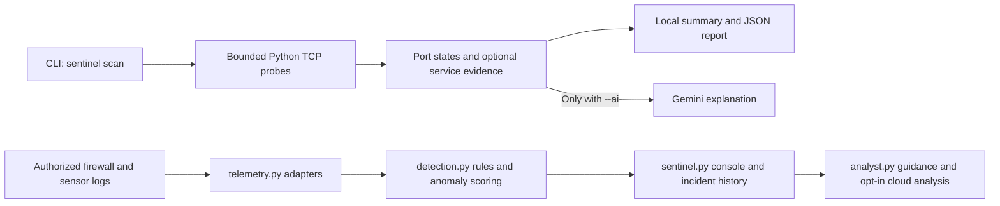

# Architecture

The scanner works independently of the monitoring dependencies. Port-database
hints, remote observations and AI text are separate from connection results.
The monitor consumes event sources; it is not the active TCP scanner. Cloud
analysis requires the relevant explicit opt-in/consent described in each flow.
Read the [scanner guide](../README.md) or [monitoring reference](MONITORING.md).
